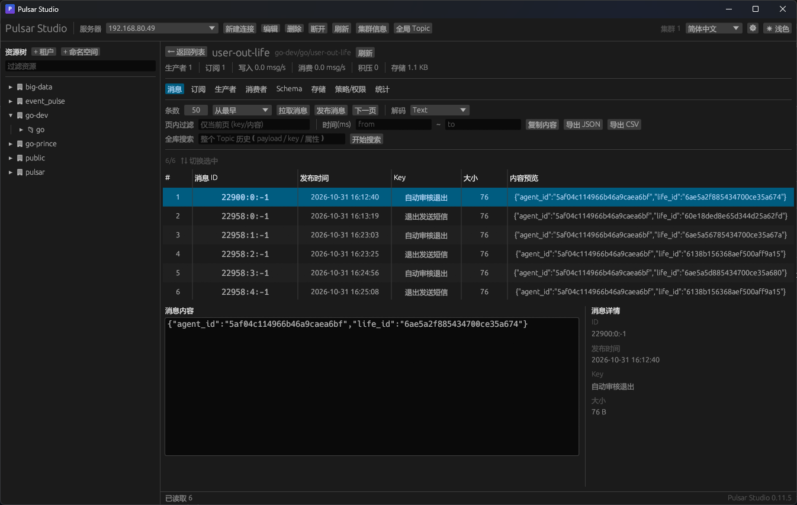

# Pulsar Studio

A cross-platform Apache Pulsar management desktop client written in Rust (egui/eframe).
纯 Rust 实现的 Apache Pulsar 图形化管理客户端，单文件可执行，无运行时依赖。




<p align="center">
  <sub>深色主题 · 三级资源树 · 消息列表 / 内容 / 详情三栏 · 全库搜索</sub>
</p>

## 功能

**连接**
- 多服务器配置（新增 / 编辑 / 删除），Admin 与 Broker 地址分开配置
- 认证方式：无认证 / Basic / JWT Token
- 配置持久化到 `~/.pulsar-studio/config.json`

**资源浏览**
- 三级资源树：租户 → 命名空间 → Topic，懒加载 + 关键字过滤
- 租户创建 / 编辑（allowedClusters、adminRoles）/ 删除
- 命名空间创建 / 删除；Topic 创建（含分区数）/ 删除

**Topic 详情**
- 概览：生产者数、订阅数、写入/消费速率、积压、存储
- 分区明细表（分区 Topic 自动按 `-partition-N` 聚合）
- 消息：按最早/最新/时间戳/消息 ID 拉取，分页、页内过滤、全库扫描搜索、排序、方向键切换、整行选中
- 解码 19 种格式：Text / JSON / XML / Hex / MsgPack / YAML / 8 种数值 / 时间戳·日期·时间 / Avro(含 Embedded)
- 发布消息（key + 自定义属性）、复制内容、导出 JSON / CSV
- 订阅管理：新建、重置游标（时间 / ID）、跳过、过期、取消订阅、**只读预览积压消息**
- 生产者 / 消费者实时列表（含客户端版本、连接地址、速率）
- 命名空间策略与权限（TTL、保留、积压配额、限流、持久化、去重、复制集群、角色授权）
- Schema、存储（ledger 明细）、统计原始 JSON

**其它**
- 全局 Topic 概览（按积压排序）
- 集群管理（新建 / 编辑 / 删除，Broker 版本）
- 三语界面（简体 / 繁體 / English）、深浅色主题、界面缩放
- 窗口尺寸、表格列宽记忆

## 构建

依赖：
- Rust（`x86_64-pc-windows-gnu` 或任意平台工具链）
- `protoc`（`pulsar` crate 需要）
- C 编译器（可选，用于消息压缩 lz4/zstd；不装就去掉 `compression` feature）

```bash
cargo build --release
# 产物：target/<triple>/release/pulsar-studio
```

Windows 无 MSVC 时可用 GNU 工具链，并在 `.cargo/config.toml` 指定链接器：

```toml
[build]
target = "x86_64-pc-windows-gnu"

[target.x86_64-pc-windows-gnu]
linker = "<path-to>/rust-lld.exe"
```

## 运行与调试

```bash
pulsar-studio
```

调试用环境变量：

| 变量 | 作用 |
|---|---|
| `PS_OPEN_TOPIC=persistent://tenant/ns/topic` | 启动后直接打开该 Topic |
| `PS_TAB=messages\|subs\|producers\|consumers\|schema\|storage\|policies\|stats` | 指定初始标签页 |
| `PS_AUTOSEARCH=<关键字>` | 打开 Topic 后自动执行全库搜索 |
| `PS_PREVIEW_SUB=<订阅名>` | 自动打开该订阅的积压预览 |
| `PS_DARK=1` / `PS_CLUSTERS=1` / `PS_SETTINGS=1` | 深色主题 / 打开集群窗口 / 打开设置 |
| `PS_DEBUG_LOG=<文件>` | 把关键状态写入文件，便于无界面排查 |
| `PS_PEEK_WAIT_MS=<毫秒>` | 拉取消息首条等待时间（默认 10000） |

## 冒烟测试

`src/bin/smoke.rs` 是一个命令行验证程序，覆盖 Admin API、消息收发、订阅、策略、Avro 解码等链路：

```bash
set PS_ADMIN_URL=http://localhost:8080
set PS_BROKER_URL=pulsar://localhost:6650
cargo run --bin smoke
```

## 说明

- 启动时自动连接上次使用的服务器
- 拉取消息使用非持久订阅，不会在集群留下订阅、也不会移动已有游标
- 全库搜索是顺序扫描（Pulsar 没有内容检索接口），有扫描量/命中数/时长上限，可随时停止

## License

未指定。如需开源请自行添加 LICENSE。
